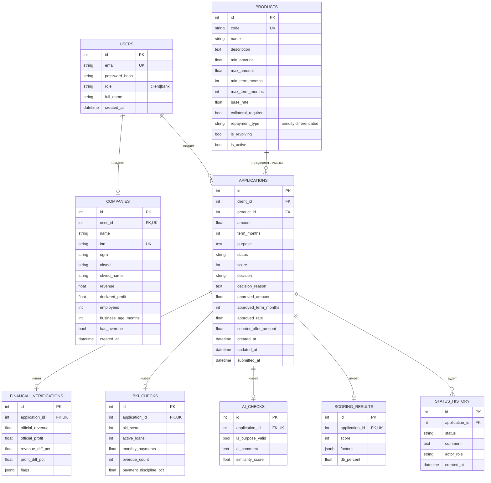

# Модель данных

СУБД: **PostgreSQL 15**. ORM: SQLAlchemy 2.0 (async, `asyncpg`).  
Миграции: `backend/alembic/versions/0001_initial.py`, `backend/alembic/versions/0002_product_categories.py`.

## ER-диаграмма



> В Mermaid для краткости не показаны технические `created_at` у части таблиц; они присутствуют в БД.

## Кредитные продукты

| `code` | Название | Сумма | Срок | Ставка | Обеспечение | Погашение | Возобновляемая |
| --- | --- | --- | --- | --- | --- | --- | --- |
| `UNSECURED` | Без залога | 100 тыс. — 5 млн ₽ | 6–36 мес. | 19.9% | нет | аннуитетный | нет |
| `SECURED` | С залогом | 300 тыс. — 10 млн ₽ | 12–60 мес. | 17.5% | залог | аннуитетный | нет |
| `CREDIT_LINE` | Кредитная линия | 300 тыс. — 5 млн ₽ | 12–36 мес. | 18.9% | нет | дифференцированный | да |

- `products.repayment_type` принимает значения `annuity` или `differentiated`.
- `products.collateral_required` показывает, требуется ли обеспечение.
- `products.is_revolving` отличает возобновляемую кредитную линию от срочного кредита.
- Миграция `0002_product_categories` переименовывает существующие продукты на месте (`WORKING_CAPITAL → UNSECURED`, `EQUIPMENT → SECURED`, `EXPRESS → CREDIT_LINE`), сохраняя `product_id` у заявок.

## Роли

| `users.role` | Возможности |
| --- | --- |
| `client` | Свои заявки, подтверждение условий, принятие/отказ от встречного предложения, подписание договора |
| `bank` | Все заявки после отправки, ручные решения по `MANUAL_REVIEW` |

## Статусы заявки

| Статус | Смысл |
| --- | --- |
| `DRAFT` | Черновик, редактируется клиентом |
| `VALIDATION` | Проверка лимитов продукта |
| `ENRICHMENT` | Получение данных ЕГРЮЛ / ГИР БО / БКИ |
| `AI_PURPOSE_CHECK` | Семантическая проверка цели |
| `SCORING` | Расчёт скоринга и DTI |
| `APPROVED` | Автоматическое или ручное одобрение |
| `COUNTER_OFFER` | Банк предложил комфортную сумму |
| `MANUAL_REVIEW` | Требуется решение менеджера |
| `REJECTED` | Отказ (hard override, скор, лимиты, отказ клиента) |
| `CONTRACT_SIGNING` | Условия согласованы, ожидается подписание |
| `DISBURSED` | Демонстрационная выдача средств |

## Связи и ограничения

- Самостоятельная регистрация отключена; пользователи и компании создаются seed и администратором банка.
- `users.email` — уникальный индекс.
- `companies.user_id` — `UNIQUE`, одна компания на клиентский профиль.
- `applications.client_id → users.id` с `ON DELETE CASCADE`.
- `applications.product_id → products.id` с `ON DELETE RESTRICT`.
- Все проверки (`financial_verifications`, `bki_checks`, `ai_checks`, `scoring_results`) имеют `application_id` с `UNIQUE` и `ON DELETE CASCADE` — по одной записи на заявку.
- `status_history.application_id → applications.id` с `ON DELETE CASCADE`; записи упорядочены по `created_at, id`.
- Составной индекс `ix_applications_status_created` ускоряет очередь банка.

## Формат JSONB

### `scoring_results.factors`

Массив объектов:

```json
[
  {
    "factor": "base",
    "label": "Базовая оценка",
    "value": "—",
    "points": 50,
    "description": "Стартовое значение скоринговой модели"
  },
  {
    "factor": "revenue",
    "label": "Выручка",
    "value": "14 800 000 ₽",
    "points": 20,
    "description": "Выручка по ГИР БО выше 10 млн ₽"
  },
  {
    "factor": "dti",
    "label": "DTI",
    "value": "4.1%",
    "points": 15,
    "description": "Низкая долговая нагрузка. Новый платёж: 50 000 ₽"
  },
  {
    "factor": "cap",
    "label": "Ограничение 0–100",
    "value": "130 → 100",
    "points": -30,
    "description": "Итоговый скор ограничен диапазоном 0–100"
  }
]
```

`factor` — машиночитаемый код: `base`, `revenue`, `profit`, `age`, `bki`, `overdue`, `dti`, `ai`, `cap`.

### `financial_verifications.flags`

Массив строк с предупреждениями:

```json
[
  "Расхождение выручки: заявлено 15 000 000 ₽, по ГИР БО 14 800 000 ₽ (-1.3%).",
  "Отрицательная прибыль по данным ГИР БО."
]
```

Порог формирования флага по выручке — 15%, по прибыли — 20%. Отрицательная официальная прибыль и наличие просрочек добавляются отдельно.

## Расчётные поля

- `applications.score` — дублирует итог из `scoring_results.score` для быстрых списков.
- `applications.decision` — итоговое решение (`APPROVED`, `COUNTER_OFFER`, `MANUAL_REVIEW`, `REJECTED`).
- `applications.counter_offer_amount` — комфортная сумма.
- `applications.approved_amount` — сумма после одобрения или принятия встречного предложения.
- `applications.approved_term_months`, `approved_rate` — согласованные условия.
- `applications.submitted_at` — момент запуска оркестратора.

## Инварианты

1. Проверки и скоринг создаются только при `submit` (не для `DRAFT`).
2. Переходы статусов валидируются `AllowedTransitions` в `backend/app/constants.py`.
3. `COUNTER_OFFER` невозможен без `counter_offer_amount`.
4. `CONTRACT_SIGNING` возможен только из `APPROVED` или `COUNTER_OFFER`.
5. `DISBURSED` возможен только из `CONTRACT_SIGNING`.
6. Банк может принимать решения только по `MANUAL_REVIEW`.
7. Все действия и автоматические этапы фиксируются в `status_history`.
